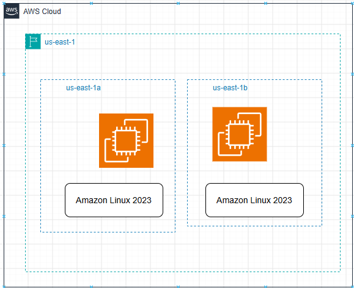
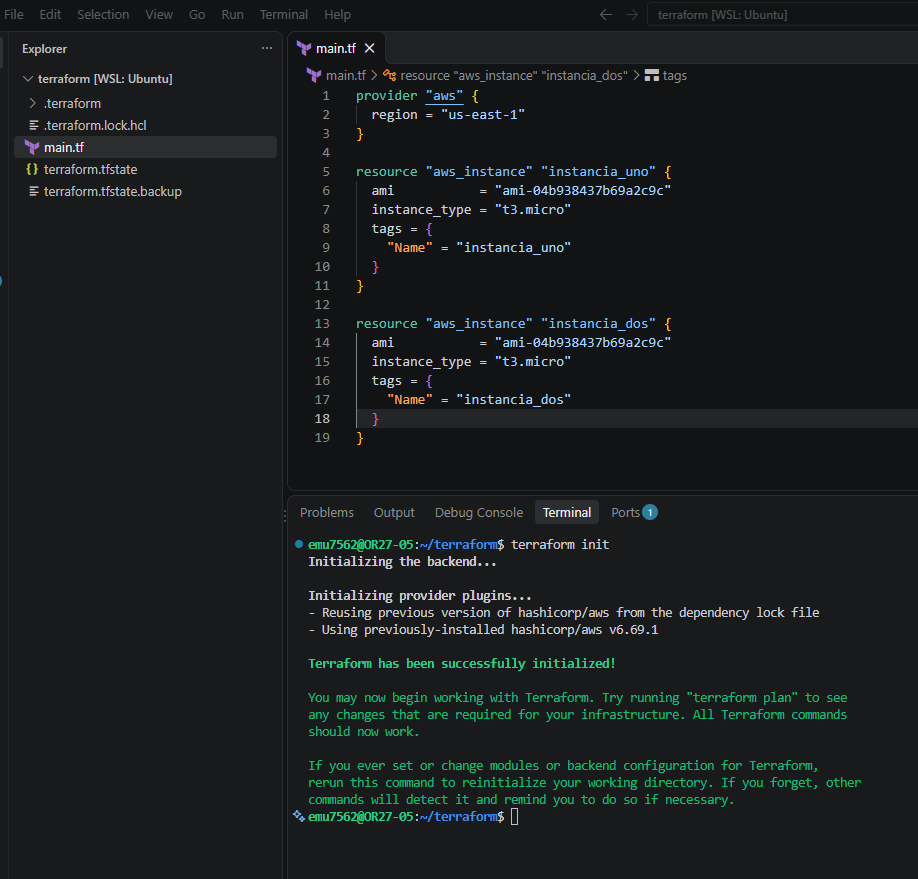
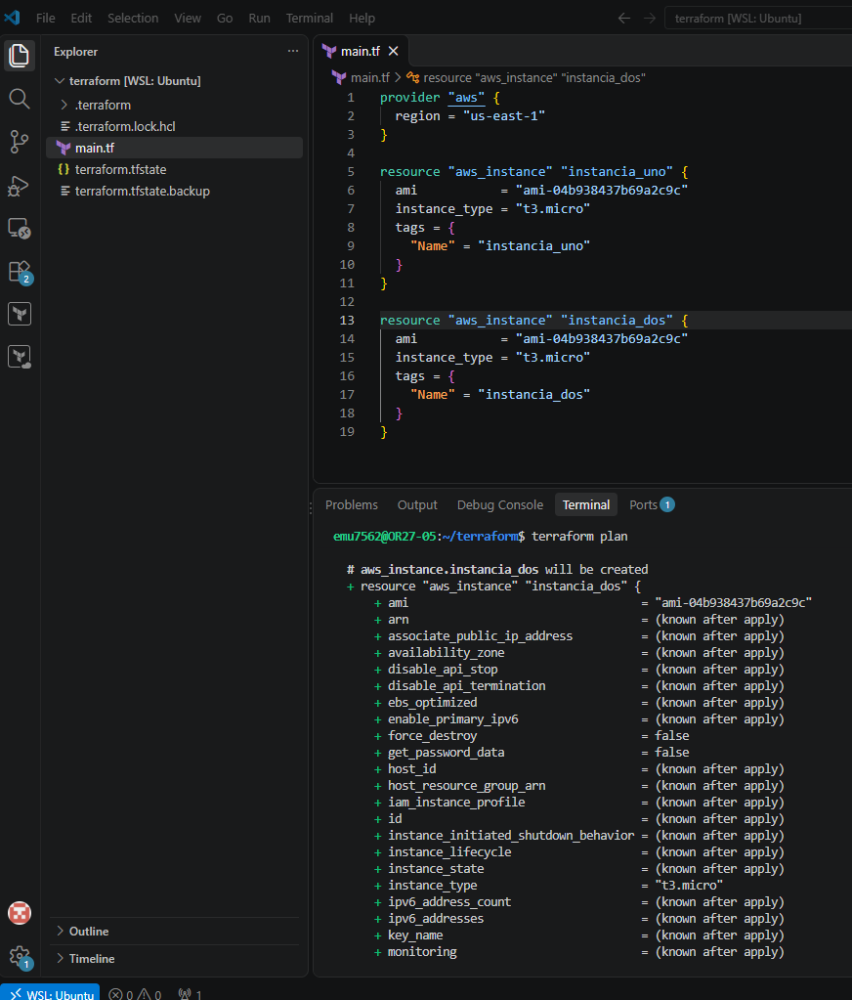
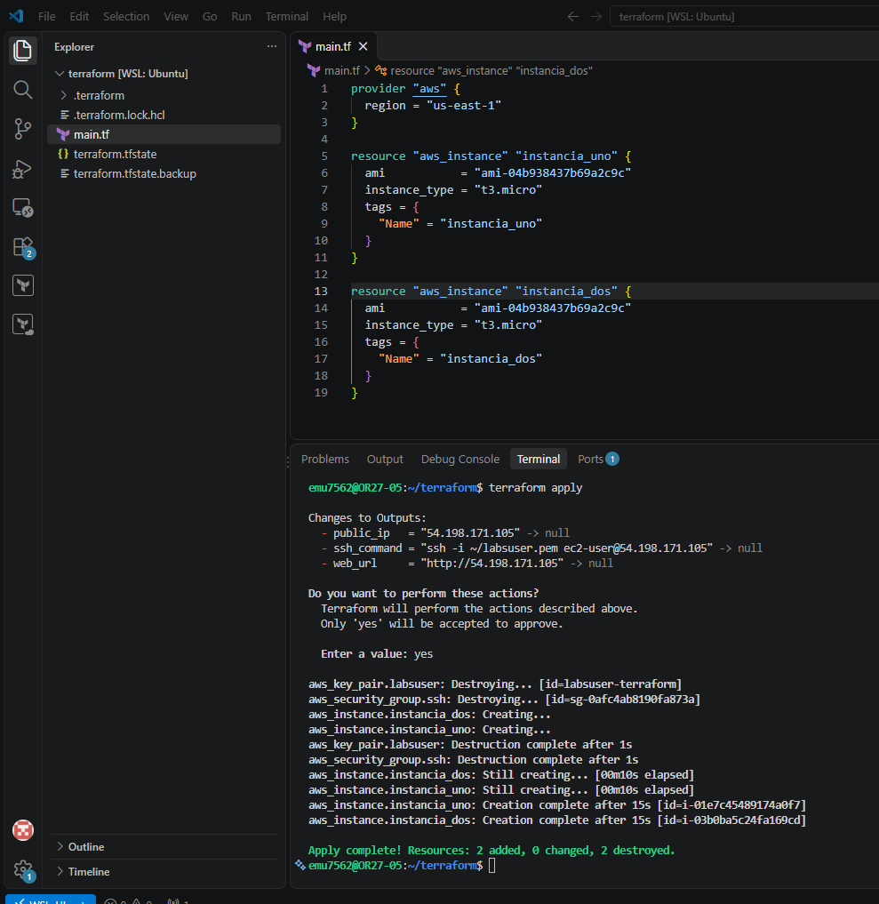
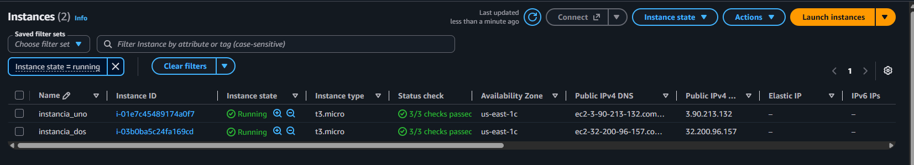
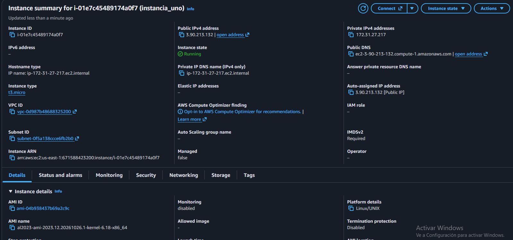
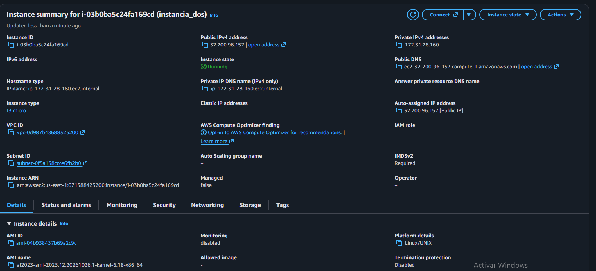

# Pasos de instalación + ejecucción de instancias con Terraform
## **Objetivo de PoC:** 

1. Crear dos instancias EC2 con Amazon Linux 2023 en una misma zona de disponibilidad.
2. Instalar y configurar el entorno Linux para el uso de Terraform.
3. Conocer el uso de los comandos básicos de Terraform.

## Diseño de referencia de la topologia



## Instalación:

### Creamos la carpeta 'terraform' en nuestro home de Linux:
```bash
cd
mkdir terraform
```

### Ejecutamos los siguientes comandos:

```bash
wget -O - https://apt.releases.hashicorp.com/gpg | sudo gpg --dearmor -o /usr/share/keyrings/hashicorp-archive-keyring.gpg
echo "deb [arch=$(dpkg --print-architecture) signed-by=/usr/share/keyrings/hashicorp-archive-keyring.gpg] https://apt.releases.hashicorp.com $(grep -oP '(?<=UBUNTU_CODENAME=).*' /etc/os-release || lsb_release -cs) main" | sudo tee /etc/apt/sources.list.d/hashicorp.list
```

### Actualizamos repositorios y instalamos mediante apt el paquete terraform (En caso que usemos Debian o una distribución basada en Debian):

```bash
sudo apt update && sudo apt install terraform -y
```
### Verificamos que se haya instalado con el comando terraform:

```bash
terraform
```

## Recurso original de Hashicorp de la instalación
Link: https://developer.hashicorp.com/terraform/install#linux


*Ahora que ya hemos instalado terraform creamos la carpeta oculta **.aws** fuera del directorio **terraform (pero en nuestro home)**, después creamos un fichero llamado **credentials** dentro de **.aws** que lo utilizamos para autenticarnos en nuestra cuenta.*

**NOTA**

*El fichero **credentials** debe contener las credenciales de aws, para acceder a ellos debemos estar autenticados en la web de aws y en los recursos de labs (AWS academy learner lab) accedemos a AWS details.*
*Copiaremos el contenido y lo agregamos al fichero, cabe resaltar que cada dia deberemos modificar dicho fichero ya que las credenciales son diferentes con cada dia que pasa.*


**NOTA**

*Ahora accedemos nuevamente al directorio de terraform y continuamos con la ejecuccion de estos comandos en este orden (comandos ejecutados en el ejercicio 1 después de la instalación).*


- terraform init
- terraform plan
- terraform apply

## Explicación de comandos basicos de terraform utilizados


1. terraform init

*Inicializa el proyecto y descarga los proveedores y módulos necesarios.*



2. terraform plan

*Muestra los cambios que Terraform realizará en la infraestructura, sin aplicarlos.*




3. terraform apply

*Aplica los cambios y crea, modifica o elimina recursos según la configuración.*

**NOTA**

*Cabe resaltar que cuando hagamos los comandos:*
```bash
terraform plan
terraform apply
```
*És importante que tengamos nuestro fichero .tf creado con antelación, con su contenido de configuración ya que lo utilizaremos para la creación de las instancias y sus respectivos parametros.*





## **Capturas de verificación**

### Instancias 



### Información instancia uno 




### Información instancia dos




4. terraform destroy

*Elimina los recursos de infraestructura gestionados por Terraform.*

**Advertencia (Solamente utilizar cuando quieras eliminar las instancias):**

**terraform destroy** *se utiliza cuando quieres eliminar la infraestructura creada y gestionada por Terraform.*


### Orden de ejecución habitual

- terraform init
- terraform plan
- terraform apply
- terraform destroy

