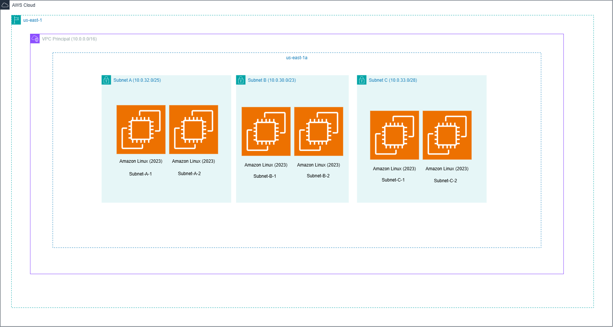
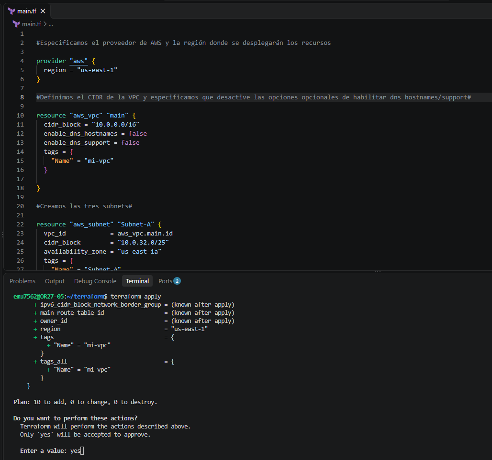
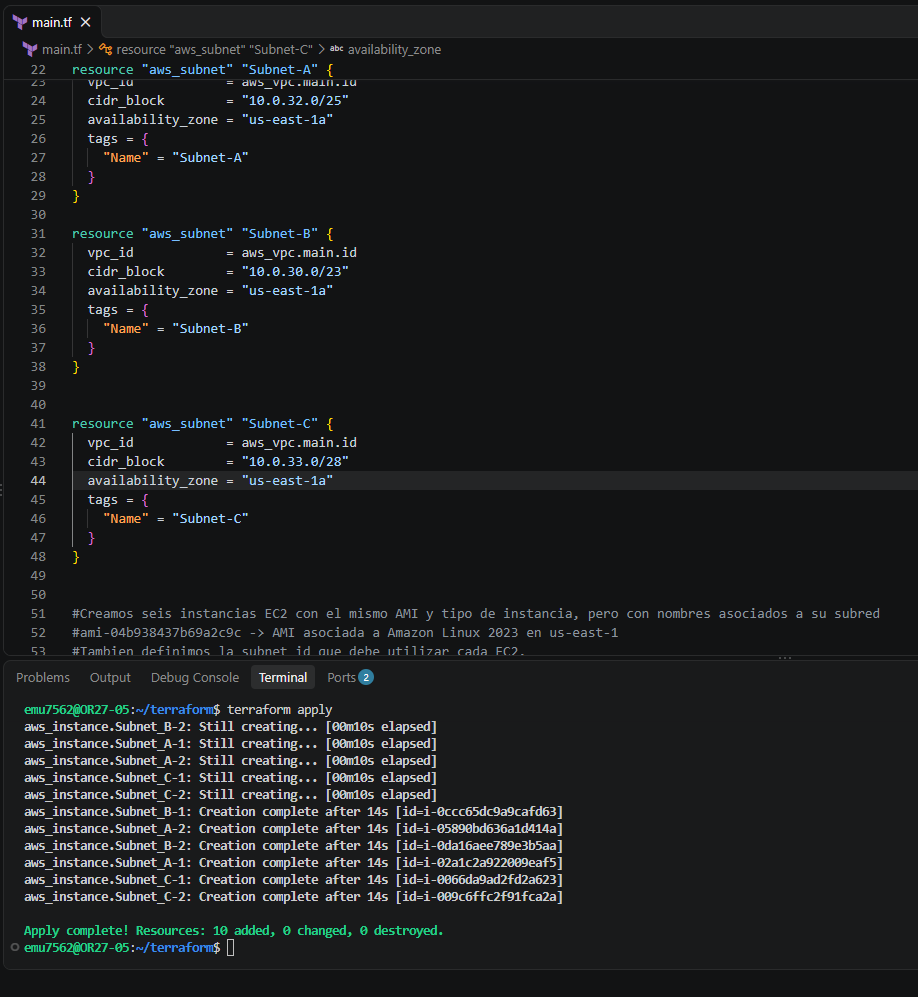
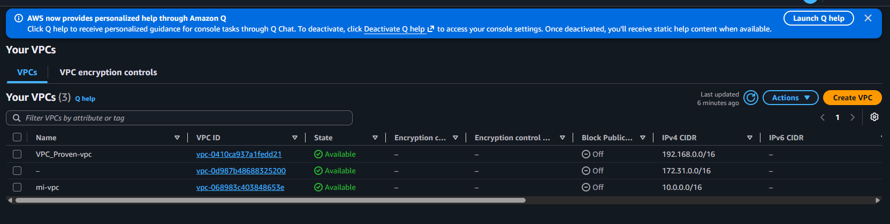
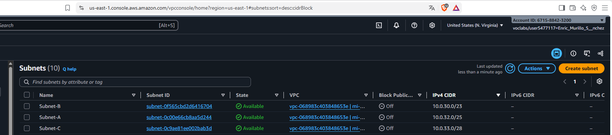
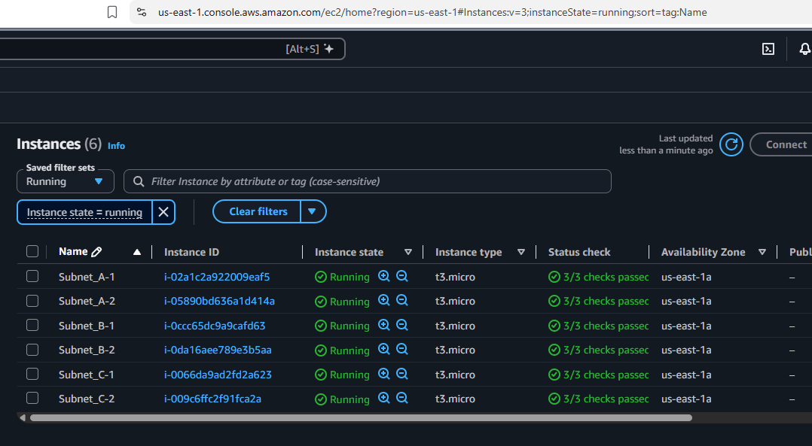

# Pasos para hacer un despliegue automatizado de IaC con Terraform
## **Objetivo de PoC:** 
1. Crear una VPC principal.
2. Crear tres subnets, cada una de las cuales tendrá dos de las seis instancias.
3. Crear seis instancias EC2 con Amazon Linux 2023. 
## Diseño de referencia de la subnet

### Creando la VPC principal 
```hcl

/*
### Definimos el CIDR de la VPC ###

resource "aws_vpc" "main" -> Indica que el recurso es una VPC que tiene el identificador main.

  cidr_block = "...." -> Indicamos el rango de direcciones IP y la máscara en formato CIDR.
  enable_dns_hostnames = false -> Indicamos que a las instancias EC2 que usen esta VPC y que tengan IP pública no se les asignen nombres DNS públicos.
  enable_dns_support = false -> Indicamos que las instancias EC2 que usen esta VPC no puedan realizar resoluciones DNS.
*/


resource "aws_vpc" "main" {
  cidr_block = "10.0.0.0/16"
  enable_dns_hostnames = false
  enable_dns_support = false
  tags = {
    "Name" = "mi-vpc"
  }

}

```

### Creando las subnets

```hcl

/*

### Creamos las tres subnets ###

resource "aws_subnet" "Subnet-A" -> Indica que estamos creando un recurso de tipo subnet con el identificador (A modo de ejemplo: Subnet-A).
vpc_id = aws_vpc.main.id -> Indica que la subred se creará dentro de la VPC con el identificador (A modo de ejemplo: main).
availability_zone = "..." -> Indicamos la zona de disponibilidad que usamos para la subred.

  *NOTA*
  A partir de aquí ya es repetir los pasos con el resto de subredes,
  adaptando sus características de identificación y direccionamiento CIDR con la topología.
*/

resource "aws_subnet" "Subnet-A" {
  vpc_id            = aws_vpc.main.id
  cidr_block        = "10.0.32.0/25"
  availability_zone = "us-east-1a"
  tags = {
    "Name" = "Subnet-A"
  }
}

resource "aws_subnet" "Subnet-B" {
  vpc_id            = aws_vpc.main.id
  cidr_block        = "10.0.30.0/23"
  availability_zone = "us-east-1a"
  tags = {
    "Name" = "Subnet-B"
  }
}


resource "aws_subnet" "Subnet-C" {
  vpc_id            = aws_vpc.main.id
  cidr_block        = "10.0.33.0/28"
  availability_zone = "us-east-1a"
  tags = {
    "Name" = "Subnet-C"
  }
}


```

### Creando las seis instancias

```hcl

/*
# Creamos seis instancias EC2 con el mismo AMI y tipo de instancia (t3.micro), pero con nombres asociados a su subred.
# ami-04b938437b69a2c9c -> AMI asociada a Amazon Linux 2023 en us-east-1.
# resource "aws_instance" "Subnet_A-1" -> Indica que el recurso es una instancia (en este ejemplo le ponemos de nombre: Subnet_A-1).
# subnet_id = aws_subnet.Subnet-A.id -> Definimos el ID de la subred que debe utilizar cada EC2 mediante su identificador (en este ejemplo es: Subnet-A).
  *NOTA*
  Teniendo en cuenta estas características, se trata de repetir los pasos con el resto de instancias,
  adaptando su identificador de subred y nombre lógico con la topología de referencia.
*/

resource "aws_instance" "Subnet_A-1" {
  ami           = "ami-04b938437b69a2c9c"
  instance_type = "t3.micro"
  subnet_id = aws_subnet.Subnet-A.id
  tags = {
    "Name" = "Subnet_A-1"
  }
}

resource "aws_instance" "Subnet_A-2" {
  ami           = "ami-04b938437b69a2c9c"
  instance_type = "t3.micro"
  subnet_id = aws_subnet.Subnet-A.id
  tags = {
    "Name" = "Subnet_A-2"
  }
}

resource "aws_instance" "Subnet_B-1" {
  ami           = "ami-04b938437b69a2c9c"
  instance_type = "t3.micro"
  subnet_id = aws_subnet.Subnet-B.id
  tags = {
    "Name" = "Subnet_B-1"
  }
}

resource "aws_instance" "Subnet_B-2" {
  ami           = "ami-04b938437b69a2c9c"
  instance_type = "t3.micro"
  subnet_id = aws_subnet.Subnet-B.id
  tags = {
    "Name" = "Subnet_B-2"
  }
}

resource "aws_instance" "Subnet_C-1" {
  ami           = "ami-04b938437b69a2c9c"
  instance_type = "t3.micro"
  subnet_id = aws_subnet.Subnet-C.id
  tags = {
    "Name" = "Subnet_C-1"
  }
}

resource "aws_instance" "Subnet_C-2" {
  ami           = "ami-04b938437b69a2c9c"
  instance_type = "t3.micro"
  subnet_id = aws_subnet.Subnet-C.id
  tags = {
    "Name" = "Subnet_C-2"
  }
}

```


### Verificamos los cambios del código y los aplicamos.
#### **Capturas**




##### **Recomendación (ejecuta cada comando individualmente para analizarlo)**

```bash
terraform plan
terraform apply
```

### Resultado vpc creada (captura final)


### Resultado subnets creadas (captura final)


### Resultado instancias creadas (captura final)


