# Pasos para hacer un despliegue automatizado de IaC con Terraform
## **Objetivo de PoC:** 
1. Crear una VPC principal.
2. Crear dos subnets públicas distribuidas en diferentes zonas de disponibilidad.
3. Crear dos instancias EC2 con Amazon Linux 2023, una en cada subnet.
4. Configurar la conectividad a Internet mediante un Internet Gateway y una tabla de rutas pública.
5. Configurar un Security Group con reglas de entrada y salida específicas.

## Requisitos previos

- Tener una cuenta de AWS activa.
- Tener Terraform instalado.
- Disponer de credenciales de AWS configuradas.
- Tener disponible el Key Pair `vockey`.
- Utilizar la región `us-east-1`.


## Diseño de referencia de la subnet
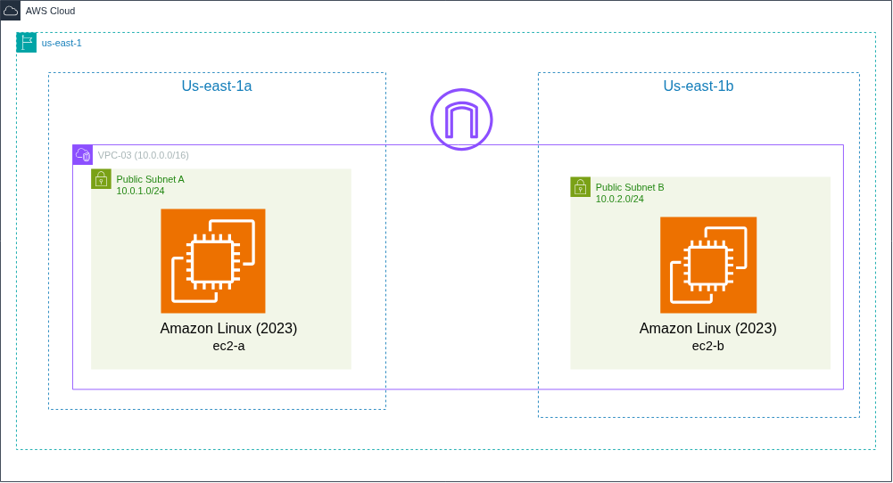
### Creando la VPC principal 
```hcl


#Especificamos el proveedor de AWS y la región donde se desplegarán los recursos

provider "aws" {
  region = "us-east-1"
}

/*
### Definimos el CIDR de la VPC ###

resource "aws_vpc" "vpc_03" -> Indica que el recurso es una VPC que tiene el identificador vpc_03.

  cidr_block = "...." -> Indicamos el rango de direcciones IP y la máscara en formato CIDR.
  enable_dns_hostnames = false -> Indicamos que a las instancias EC2 que usen esta VPC y que tengan IP pública no se les asignen nombres DNS públicos.
  enable_dns_support = false -> Indicamos que las instancias EC2 que usen esta VPC no puedan realizar resoluciones DNS.
*/


resource "aws_vpc" "vpc_03" {
  cidr_block = "10.0.0.0/16"
  enable_dns_hostnames = false
  enable_dns_support = false
  tags = {
    "Name" = "VPC-03"
  }

}

/*

### Creamos las dos subnets ###

resource "aws_subnet" "Public_Subnet-A" -> Indica que estamos creando un recurso de tipo subnet con el identificador (A modo de ejemplo: Public_Subnet-A).
vpc_id = aws_vpc.vpc_03.id -> Indica que la subred se creará dentro de la VPC con el identificador (A modo de ejemplo: vpc_03).
availability_zone = "..." -> Indicamos la zona de disponibilidad que usamos para la subred.
map_public_ip_on_launch = true -> Permite asignar automáticamente una IP pública a las nuevas instancias EC2 lanzadas en esta subnet.

  *NOTA*
  A partir de aquí ya es repetir los pasos con el resto de subredes,
  adaptando sus características, identificación y direccionamiento CIDR con la topología.
*/

resource "aws_subnet" "Public_Subnet-A" {
  vpc_id            = aws_vpc.vpc_03.id
  cidr_block        = "10.0.1.0/24"
  availability_zone = "us-east-1a"
  map_public_ip_on_launch = true
  tags = {
    "Name" = "Public_Subnet-A"
  }
}

resource "aws_subnet" "Public_Subnet-B" {
  vpc_id            = aws_vpc.vpc_03.id
  cidr_block        = "10.0.2.0/24"
  availability_zone = "us-east-1b"
  map_public_ip_on_launch = true
  tags = {
    "Name" = "Public_Subnet-B"
  }
}

##Creamos el Internet Gateway y lo asociamos a la VPC###

resource "aws_internet_gateway" "igw" {
  vpc_id = aws_vpc.vpc_03.id
  tags = {
    Name = "Internet_Gateway_VPC03"
  }
}

##Creamos la tabla de rutas pública###

resource "aws_route_table" "rt_publica_01" {
  vpc_id = aws_vpc.vpc_03.id
  tags = {
    Name = "rt_publica_01"
  }
}

#Creamos las rutas, las agregamos a la tabla y especificamos el igw por el que pasaran.#

resource "aws_route" "ruta_internet_01" {
  route_table_id = aws_route_table.rt_publica_01.id
  destination_cidr_block = "0.0.0.0/0"
  gateway_id = aws_internet_gateway.igw.id
}


#Asociamos la tabla de rutas publica a las dos subnets#

resource "aws_route_table_association" "asociacion_publica_01" {
  route_table_id = aws_route_table.rt_publica_01.id
  subnet_id = aws_subnet.Public_Subnet-A.id
}

resource "aws_route_table_association" "asociacion_publica_02" {
  route_table_id = aws_route_table.rt_publica_01.id
  subnet_id = aws_subnet.Public_Subnet-B.id
}


#Creamos un grupo de seguridad#

resource "aws_security_group" "sg_01" {
  description = "Grupo de seguridad para las instancias."
  vpc_id = aws_vpc.vpc_03.id
  tags = {
    Name = "sg_01"
  }
}

#Especificamos las reglas de inbound#

resource "aws_vpc_security_group_ingress_rule" "ssh_01" {
  security_group_id = aws_security_group.sg_01.id
  description = "Permitir SSH"
  ip_protocol = "tcp"
  from_port = 22
  to_port = 22
  cidr_ipv4 = "0.0.0.0/0"
}


resource "aws_vpc_security_group_ingress_rule" "icmp_01" {
  security_group_id = aws_security_group.sg_01.id
  description = "Permitir ICMP desde la VPC"
  ip_protocol = "icmp"
  #Con from_port = "-1" -> Indicamos todos los tipos de paquetes ICMP en el rango de inicio.
  from_port = -1
  #Con to_port = "-1" -> Indicamos todos los tipos de paquetes ICMP en el final del rango.
  to_port = -1
  cidr_ipv4 = "10.0.0.0/16"
}

#Especificamos las reglas de outbound#
  #Con ip_protocol = "-1" -> Indicamos todos los protocolos que se incluye en el trafico de salida.

resource "aws_vpc_security_group_egress_rule" "salida_01" {
  security_group_id = aws_security_group.sg_01.id
  ip_protocol = "-1"
  cidr_ipv4 = "0.0.0.0/0"
}


/*
# Creamos dos instancias EC2 con el mismo AMI y tipo de instancia (t3.micro), pero con nombres asociados a su subred.
# ami-04b938437b69a2c9c -> AMI asociada a Amazon Linux 2023 en us-east-1.
# resource "aws_instance" "ec2-a"  -> Indica que el recurso es una instancia (en este ejemplo le ponemos de nombre: ec2-a).
# subnet_id = aws_subnet.Public_Subnet-A.id -> Definimos el ID de la subred que debe utilizar cada EC2 mediante su identificador (en este ejemplo es: Public_Subnet-A).
# key_name = "vockey" ->  Utiliza el par de claves vockey.
# vpc_security_group_ids = [aws_security_group.sg_01.id] -> Especificamos el id del grupo de seguridad.
  Utilizamos los corchetes [] ya que terraform espera un tipo list (array) de strings al definir los grupos de segurida den las instancias.

*NOTA*
  Teniendo en cuenta estas características, se trata de repetir los pasos con el resto de instancias,
  adaptando su identificador de subred y nombre lógico con la topología.
*/

resource "aws_instance" "ec2-a" {
  ami           = "ami-04b938437b69a2c9c"
  instance_type = "t3.micro"
  subnet_id = aws_subnet.Public_Subnet-A.id
  key_name = "vockey"
  vpc_security_group_ids = [aws_security_group.sg_01.id]
  tags = {
    "Name" = "ec2-a"
  }
}

resource "aws_instance" "ec2-b" {
  ami           = "ami-04b938437b69a2c9c"
  instance_type = "t3.micro"
  subnet_id = aws_subnet.Public_Subnet-B.id
  key_name = "vockey"
  vpc_security_group_ids = [aws_security_group.sg_01.id]
  tags = {
    "Name" = "ec2-b"
  }
}

```

### Verificamos los cambios del código y los aplicamos.
#### **Capturas**

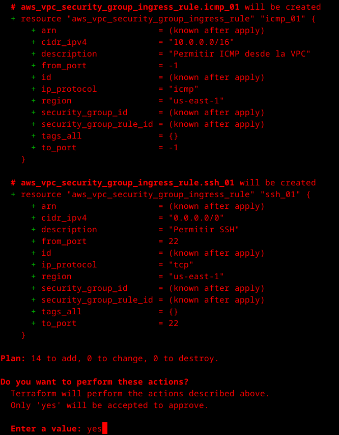

### Cambios aplicados después del apply ###
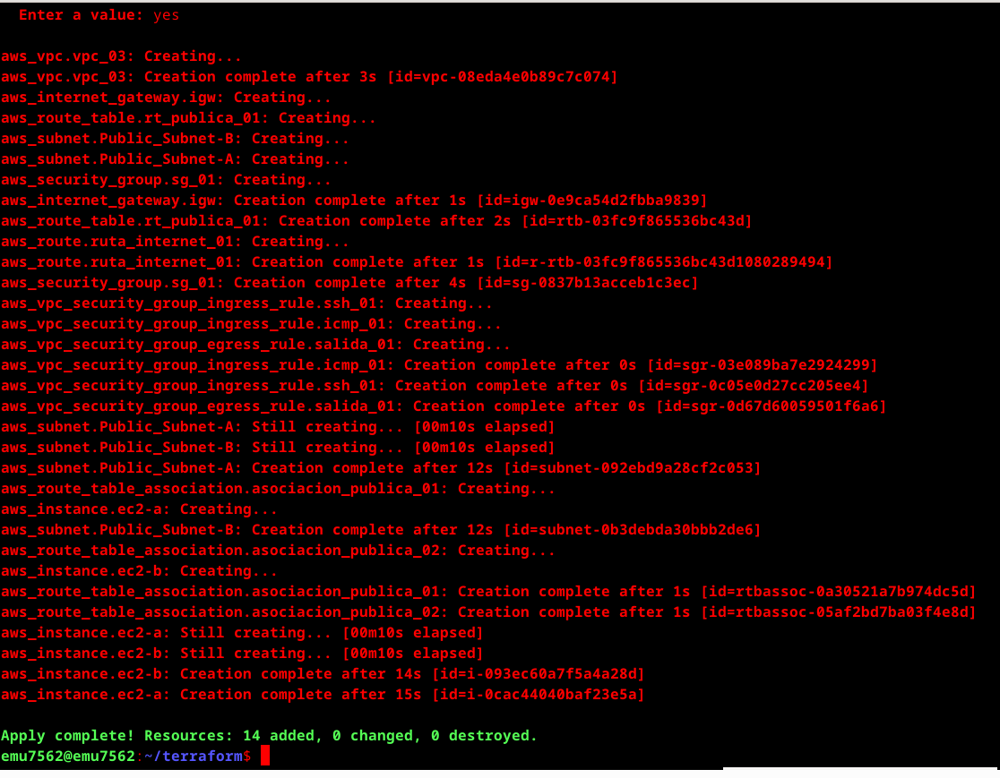

### Resultado instancias creadas (captura final) ###
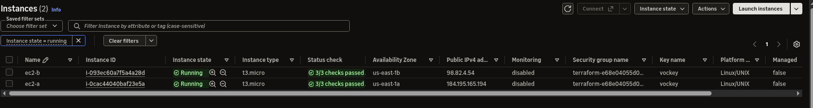

### Subnets creadas ###

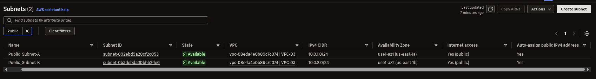

### Resultado vpc creada (captura final) ###
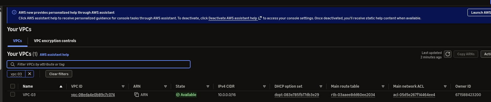

### Resultado grupo de seguridad creado (captura final) ###
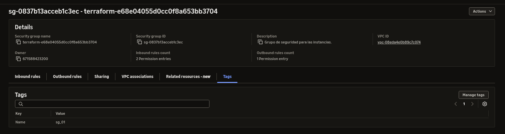

#### Security group inbound rules (captura final) ####
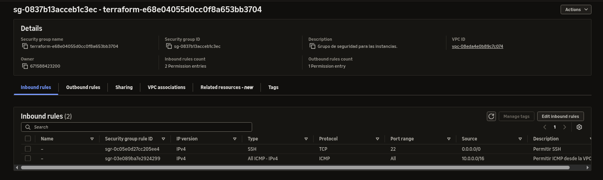

#### Security group outbound rules (captura final) ####

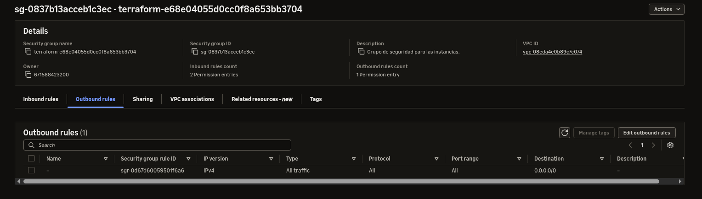

### Resultado Internet Gateway creado (captura final) ###
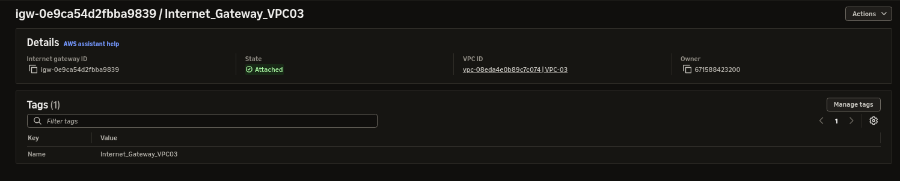

### Resultado tabla de enrutamiento (captura final) ###

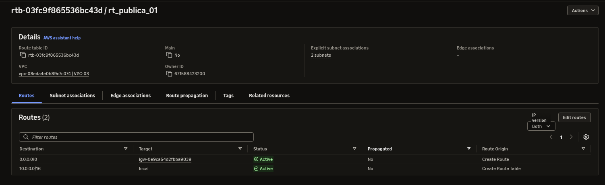

### Resultado subnets asociadas a la tabla de enrutamiento (captura final) ###

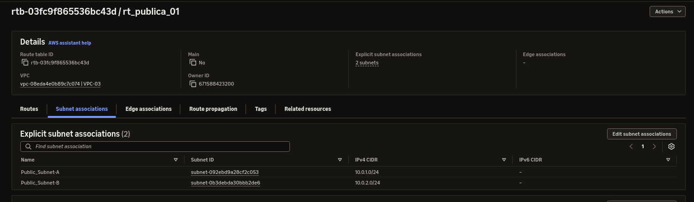
